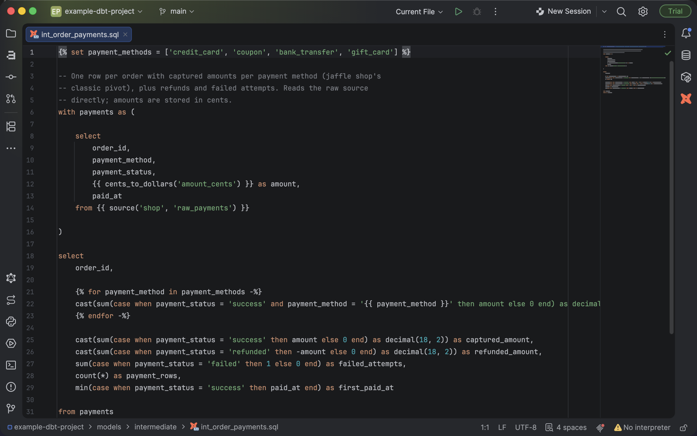
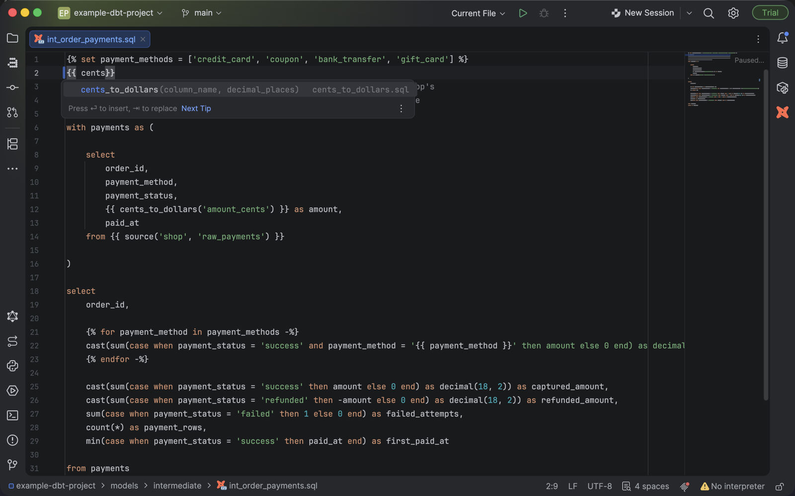
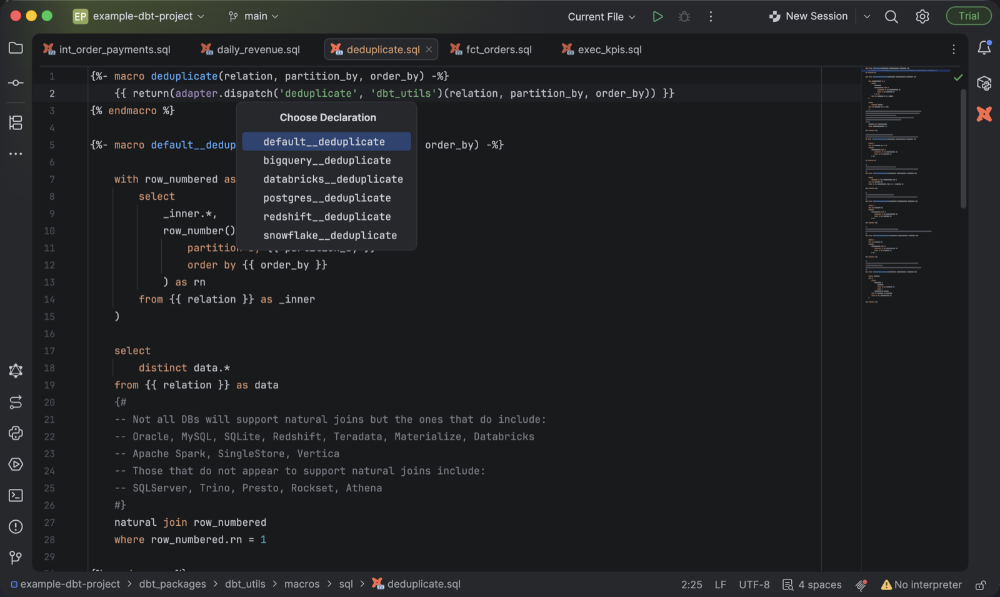
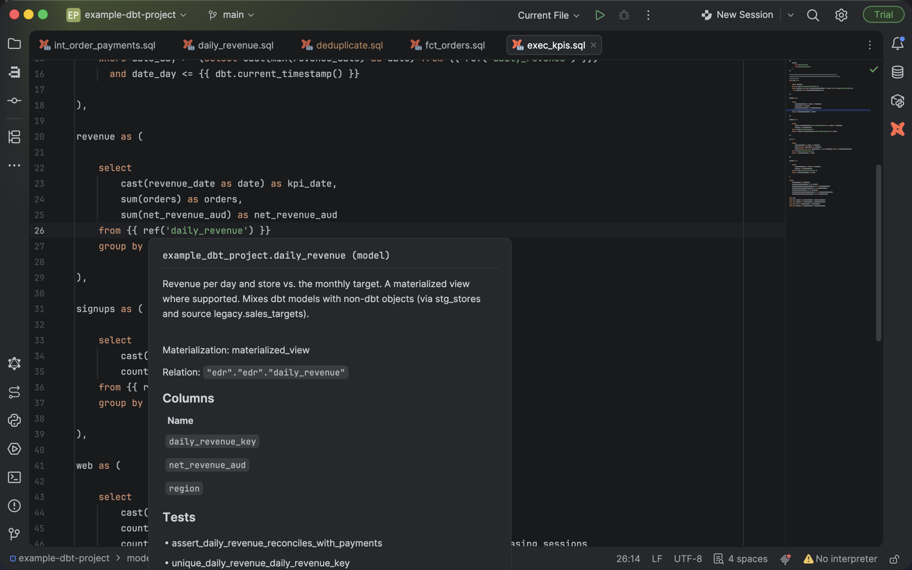
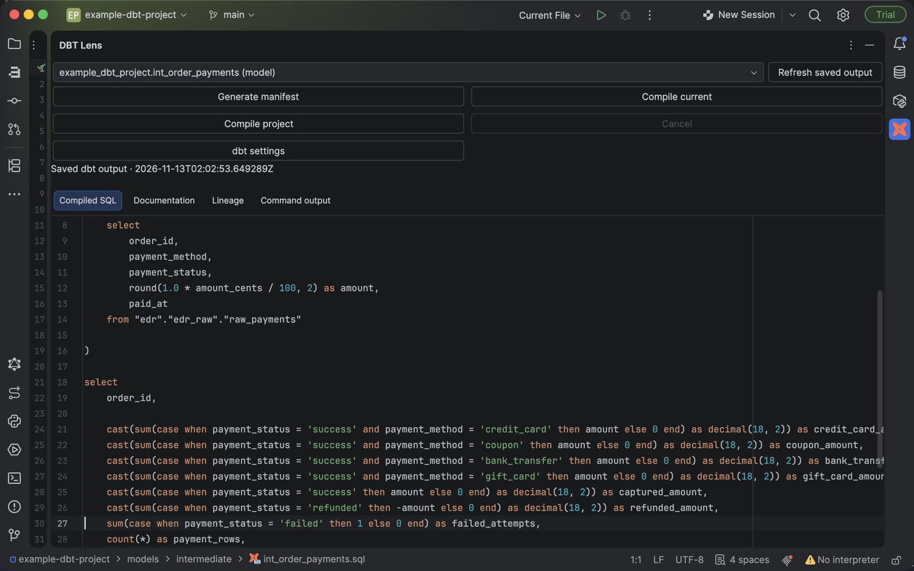

# DBT Lens user guide

This guide covers what each feature does and where its limits are. For installation, see the
[README](../README.md).

- [How files are detected](#how-files-are-detected)
- [Editing Jinja](#editing-jinja)
- [Completion](#completion)
- [Macro navigation](#macro-navigation)
- [Resource navigation](#resource-navigation)
- [Adapter dispatch](#adapter-dispatch)
- [YAML assistance](#yaml-assistance)
- [SQL editing modes](#sql-editing-modes)
- [Saved dbt output](#saved-dbt-output)
- [Running dbt commands](#running-dbt-commands)
- [Not yet supported](#not-yet-supported)

## How files are detected

Every `.sql` file under a `dbt_project.yml` inside an IDE content root becomes a Jinja template
automatically. The global SQL file association is left alone, so the file type may still show as
**SQL** or **TextMate**. Files outside dbt projects keep their normal SQL behavior.

- `*.dbt.sql`, `*.jinja` and `*.j2` are always Jinja templates.
- For any other file, use **Override File Type → dbt Jinja**.
- `target`, `logs`, `.git`, virtual environments and `node_modules` are excluded. Custom output
  directories are not excluded yet.
- After upgrading the plugin, restart the IDE and reopen models to refresh their language.

Try [examples/local-macros.dbt.sql](../examples/local-macros.dbt.sql) to see completion, navigation and
usages in action.

## Editing Jinja

- **Highlighting**: Jinja and SQL are colored independently. SQL coloring is lexical (keywords, strings,
  comments, numbers), not dialect-aware. Colors are under
  **Settings → Editor → Color Scheme → DBT Lens**.
- **Parsing**: the parser preserves source exactly, recovers at the next Jinja tag after an error, and
  reports missing block ends and delimiters. It supports inline conditionals, filtered `for` loops,
  argument unpacking, slices, `+`/`-` whitespace control, `with`/`call` blocks, dbt `docs` blocks and
  `break`/`continue`.
- **Folding**: macro and block bodies, `elif`/`else` branches, multiline tags, calls, collections and
  comments. Macro folding keeps the full signature visible.
- **Closing tags**: Go to Declaration on `endmacro`, `endif`, `endfor` or `endset` jumps to the opener.
- **Typing aids**: `{%`, `{{` and `{#` insert their closers, and typing over an existing closer works.
  This follows the IDE's bracket-pairing setting.
- **Block templates**: accepting `macro`, `if`, `for`, `with` or `call` from completion inserts a full
  block; Tab moves between placeholders. Pressing Enter after an opening tag at the end of a file adds
  the matching end tag.
- **Icons**: dbt configuration YAML and SQL files in dbt projects get dbt icons.

**Limits:** this is a Jinja editing subset, not a full runtime-equivalent grammar. Some statement
headers are only balanced-token structures, and SQL strings or comments crossing a Jinja expression
aren't context-aware yet.

## Completion

- Variables in scope: macro parameters, earlier `set` bindings, loop/with/call bindings, and contextual
  names such as `loop`, `caller`, `kwargs` and `varargs`.
- Macro and builtin signatures, with keyword-argument labels. Labels you already supplied are hidden.
- Separate catalogs for filters and tests.
- Members of literals and known dbt objects, including chains such as `graph.nodes.items()` or
  `api.Relation.create(...).include(...)`. Unknown receivers get no guessed methods.
- Hover documentation for builtins and members, and special highlighting for `api.Relation` and
  `api.Column`.

**Limits:** type inference is deliberately shallow: literals, simple aliases, iteration, common filter
results and documented dbt return types. It doesn't execute Python or Jinja or infer arbitrary macro
return values. Hook-only variables such as `results` are offered as hints. Python method signatures use
a common subset across Python versions.

The catalog follows the [Jinja template reference](https://jinja.palletsprojects.com/en/stable/templates/),
[dbt Jinja functions](https://docs.getdbt.com/reference/dbt-jinja-functions),
[dbt classes](https://docs.getdbt.com/reference/dbt-classes) and the
[dbt Core 1.10.6 context](https://github.com/dbt-labs/dbt-core/tree/v1.10.6/core/dbt/context).

## Macro navigation

- **Go to Declaration** and **Find Usages** work for static calls to top-level macros in the current
  project and installed packages, including qualified calls such as `elementary.edr_type_timestamp()`.
- Calls inside `set`, `if`/`elif`, `for` and `do` are included, as are macros passed as values.
- Unqualified calls prefer the current project. Duplicate definitions show every candidate.
- Packages are found under `dbt_packages` or a literal `packages-install-path`, even when excluded from
  indexing.
- **Quick Documentation** on a macro shows the Jinja or SQL comment directly above its declaration, as
  plain text.
- Local variables support Go to Declaration, Find Usages and usage highlighting, with separate scopes
  for nested loops.

**Limits:** unknown filters can navigate to a same-named macro as a convenience, but that doesn't prove
the macro is registered as a filter. Dynamic arguments and runtime-generated namespaces aren't resolved.
Rename is disabled until project-wide references are complete.

## Resource navigation

Go to Declaration on a literal `ref()` or `source()` call, or its string arguments, opens the resource.

- `ref` finds SQL and Python models, CSV seeds and SQL/YAML snapshots, including packages and
  `ref('package', 'model')`.
- Versioned models are selected by `v`/`version` arguments and YAML `latest_version`/`defined_in`.
- `source('src', 'table')` opens the table's YAML entry.
- With YAML support installed, exposure `depends_on` entries and `metric()` calls also navigate.
- Current-project resources take precedence over packages; duplicates show every candidate.

**Limits:** only literal resource folders are read. Without `latest_version`, only integer versions are
inferred. Dynamic expressions stay unresolved. Resource completion and rename aren't implemented. YAML
and snapshot reads are capped at 2 MB.

## Adapter dispatch

On `adapter.dispatch('format_value', 'utils')`, use Go to Declaration on `dispatch` or the macro name to
choose among `default__format_value`, `snowflake__format_value` and other implementations.

- Defaults are listed first within each package.
- Package order follows a literal root `dispatch.search_order` when YAML support is installed.
- From an adapter-specific implementation, Go to Declaration opens the package's `default__` version.
- Find Usages on an implementation includes dispatch call sites and direct calls.
- `macro_name=` and `macro_namespace=` keyword arguments are supported.

**Limits:** results are the *available* implementations, not a prediction of which one your adapter
will pick. Adapter inheritance, runtime registration and built-in dbt macros that aren't in installed
source are not inferred. See dbt's [dispatch](https://docs.getdbt.com/reference/dbt-jinja-functions/dispatch)
and [search order](https://docs.getdbt.com/reference/project-configs/dispatch-config) docs.

## YAML assistance

With JetBrains JSON and YAML support installed:

- `dbt_project.yml`, `profiles.yml`, `packages.yml`, `dependencies.yml` and `selectors.yml` get
  completion and validation from bundled schemas.
- Property YAML in model, seed, snapshot, test, analysis and macro folders gets the properties schema.
  Custom folder lists in `dbt_project.yml` are respected.
- `~/.dbt/profiles.yml` is covered when a dbt root is an IDE content root.

Schemas come from [dbt Labs' official repository](https://github.com/dbt-labs/dbt-jsonschema) (pinned
commit `6a401244`, Apache-2.0) and work offline. The profiles schema covers the common structure and
leaves adapter-specific keys open.

**Limits:** these are editor checks, not adapter or runtime validation. Your own schema mappings take
precedence as usual.

## SQL editing modes

| Mode | What you get |
| --- | --- |
| **Jinja editor** (default) | Full Jinja support with lexical SQL coloring. No SQL dialect parsing, completion or inspections. |
| **Native SQL editor** | JetBrains' SQL editor and dialect settings. Jinja features only in `.jinja`, `.j2` and `.dbt.sql` files. |

Switch under **Settings → Languages & Frameworks → DBT Lens → Keep the native SQL editor in dbt
projects** (requires Database Tools), then restart the IDE. Using both at once in the same file isn't supported yet.

An experimental PostgreSQL integration can be tried with `./gradlew runIde -PexperimentalSql=true`.
It isn't suitable for daily use: removing templates can produce misleading SQL errors.

## Saved dbt output

Open a resource file, then **View → Tool Windows → DBT Lens**. The panel reads `manifest.json` and,
optionally, `catalog.json` from the project's `target` directory (or a literal `target-path`).

- **Compiled SQL**: the saved compiled code, read-only. Macros and Python models aren't shown as SQL.
- **Documentation**: descriptions, macro arguments, columns and types, the physical relation name and
  tests, rendered with the IDE's fonts and theme. Text is escaped; Markdown and Jinja aren't evaluated.
- **Lineage**: upstream, downstream or both, depth 1–3, up to 80 resources. Click a node to open it.
  Tests and macros are hidden unless **Tests and macros** is checked. This is resource lineage, not
  column lineage.

Source changes since the artifact was generated, including unsaved edits, show a staleness warning.
Configuration, dependency or warehouse changes aren't fully detected.

**Limits:** manifest schemas v8–v12 and catalog v1. Reads are capped at 64 MB and 100,000 resources
per artifact, and 2 million characters of compiled text. Paths outside the project's output directory,
including symlinks, are rejected.

## Running dbt commands

| Action | Runs |
| --- | --- |
| **Generate manifest** | `dbt parse` |
| **Compile current** | `dbt compile` for the selected resource; for a macro file, a dialog for `dbt compile --inline` with your arguments |
| **Compile project** | `dbt compile` for the whole project |

Commands save pending edits first, show progress and output in the tool window, and can be cancelled.
One command runs per IDE project, and the panel refreshes when it finishes. Compilation may query your
warehouse. Nothing runs from opening files, indexing or hovering.

Configure under **Settings → Languages & Frameworks → DBT Lens**:

- **dbt executable**: leave blank to use `.venv`/`venv` in the project, then `PATH`. dbt Core 1.5+ is
  required for inline compilation.
- **Profiles directory**, **Profile override**, **Target**: optional; blank uses dbt's defaults.
- **Environment file**: optional `NAME=value` lines (with optional `export`, quotes and comments). Only
  the path is stored. Values aren't expanded or executed.

The executable runs locally without a shell. Remote/WSL execution and interactive authentication
prompts aren't supported. `dbt parse` can replace earlier compiled output, so compile again for a SQL
preview. Run `dbt docs generate` yourself for catalog data.

## Not yet supported

- Configuration-aware discovery of every resource folder and complete scope resolution
- Resource completion, parameter info, argument and resource inspections
- Safe rename
- Live compilation and other dbt commands (`run`, `run-operation`, `docs generate`)
- Simultaneous native SQL and Jinja assistance in one file

Design notes and qualification history are in [feasibility.md](feasibility.md).
